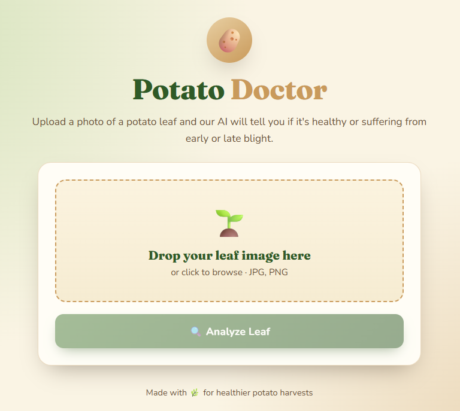

# Potato Doctor – Leaf Disease Detector


A FastAPI web app that uses a TensorFlow image-classification model to detect potato leaf conditions:
**Early Blight**, **Late Blight**, or **Healthy**.

## Setup

```bash
git clone https://github.com/BadrKandri/Deep-Learning/tree/main/CNN%20Image%20Classifier
cd "CNN Image Classifier"
python -m venv .venv
.venv\Scripts\activate
pip install -r requirements.txt
```

## Run

```bash
python main.py
```

Open [http://localhost:8000](http://localhost:8000) in a browser.

## Project Structure

- `main.py` – FastAPI application entry point
- `routers/api.py` – prediction API and model loading
- `models/model_v1.keras` – trained TensorFlow model
- `static/index.html` – web interface
- `data/` – image dataset
